# Lab6Web — Praktikum 6: JavaScript DOM dan Event Handling

**Mata kuliah:** Pemrograman Web · **Pertemuan:** 7  
**Nama:** Alleizandro Lim Hianto Prasetya · **NIM:** 312510395 · **Kelas:** I252A

Proyek ini mengerjakan seluruh latihan dan mini project dari Modul Praktikum 6: pemilihan dan manipulasi DOM, event listener, validasi form, To-do List, Form Pendaftaran Workshop, dan eksperimen mandiri. Jawaban tujuh pertanyaan evaluasi tersedia sebagai PDF terpisah: [`Jawaban_Evaluasi_Lab6Web.pdf`](Jawaban_Evaluasi_Lab6Web.pdf).

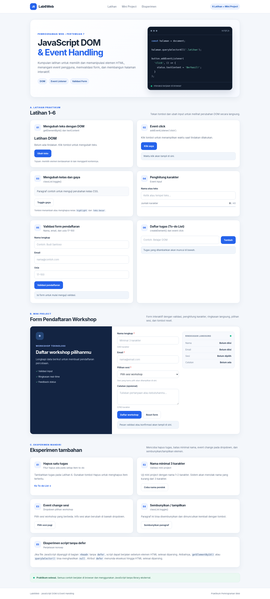

## 1. Tujuan

1. Memahami DOM sebagai representasi dokumen HTML yang dapat diakses dan dimanipulasi dengan JavaScript.
2. Memilih elemen HTML memakai `getElementById()`, `querySelector()`, dan selector CSS.
3. Mengubah teks, kelas CSS, dan tampilan melalui JavaScript.
4. Menangani tindakan pengguna memakai `addEventListener()`.
5. Menguji validasi form untuk input valid dan tidak valid.
6. Membuat halaman interaktif dan mendokumentasikan hasil uji dengan screenshot.

## 2. Struktur File

```text
Lab6Web/
├── index.html
├── style.css
├── script.js
├── README.md
├── Jawaban_Evaluasi_Lab6Web.pdf
└── screenshots/
    ├── 00-overview.png
    ├── 01-latihan-1-dom-text.png
    ├── 02-latihan-2-event-click.png
    ├── 03-latihan-3-toggle-style.png
    ├── 04-latihan-4-character-counter.png
    ├── 05a-validasi-semua-kosong.png
    ├── 05b-validasi-nama-kosong.png
    ├── 05c-validasi-email-tidak-valid.png
    ├── 05d-validasi-usia-di-bawah-17.png
    ├── 05e-validasi-berhasil.png
    ├── 06a-todolist-input-kosong.png
    ├── 06b-todolist-tugas-ditambahkan.png
    ├── 06c-todolist-tugas-selesai.png
    ├── 07a-workshop-validasi-kosong.png
    ├── 07b-workshop-nama-pendek.png
    ├── 07c-workshop-email-tidak-valid.png
    ├── 07d-workshop-sesi-belum-dipilih.png
    ├── 07e-workshop-pendaftaran-valid.png
    ├── 07f-workshop-reset-form.png
    ├── 10a-eksperimen-hapus-tugas.png
    ├── 10b-eksperimen-validasi-nama-pendek.png
    ├── 10c-eksperimen-event-change-sesi.png
    ├── 10d-eksperimen-paragraf-disembunyikan.png
    ├── 10e-eksperimen-paragraf-ditampilkan.png
    ├── 10f-eksperimen-script-tanpa-defer.png
    └── 11-responsive-mobile.png
```

## 3. Cara Menjalankan

**Pilihan A — cara paling sederhana**

1. Ekstrak folder proyek jika diunduh dari ZIP.
2. Buka `index.html` menggunakan browser modern (Chrome, Edge, atau Firefox).
3. Tekan tombol pada tiap latihan dan coba input yang tersedia.

**Pilihan B — Visual Studio Code**

1. Buka folder `Lab6Web` di VS Code.
2. Jalankan `index.html` dengan ekstensi Live Server.
3. Buka Developer Tools jika ingin melihat console browser.

Tidak diperlukan instalasi npm atau library eksternal. `index.html` menghubungkan `style.css` dan `script.js`; JavaScript menggunakan atribut `defer` agar elemen HTML selesai diparsing sebelum kode memilih elemen.

## 4. Langkah Kerja

### Latihan 1 — Mengubah teks dengan DOM
Menggunakan `getElementById()` dan `textContent`. Klik **Ubah teks** untuk mengubah judul dan pesan pada halaman.

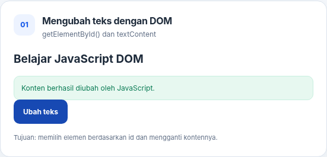

### Latihan 2 — Event click
Menggunakan `addEventListener('click', ...)`. Klik **Klik saya** untuk menampilkan waktu saat tombol ditekan.

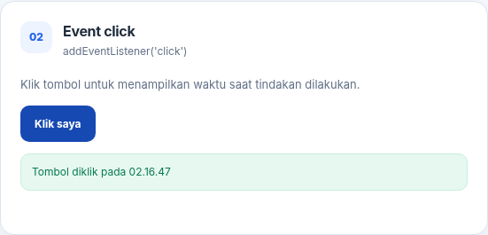

### Latihan 3 — Mengubah kelas dan gaya CSS
Menggunakan `classList.toggle()` untuk menambah atau menghapus kelas `highlight` dan `teks-besar`.

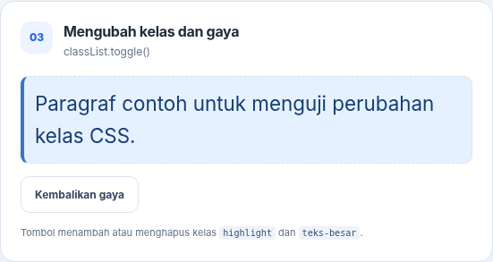

### Latihan 4 — Penghitung karakter
Event `input` menghitung jumlah karakter saat pengguna mengetik, menghapus, atau menempelkan teks.

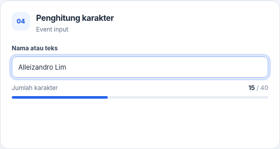

### Latihan 5 — Validasi form pendaftaran
Form memeriksa nama wajib, format email, dan usia bilangan bulat pada rentang 17–100. Seluruh kasus yang diminta modul diuji.

| Kasus uji | Hasil screenshot |
|---|---|
| Semua kolom kosong | 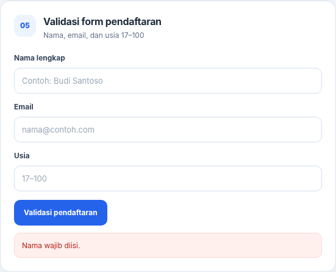 |
| Nama kosong, kolom lain terisi | 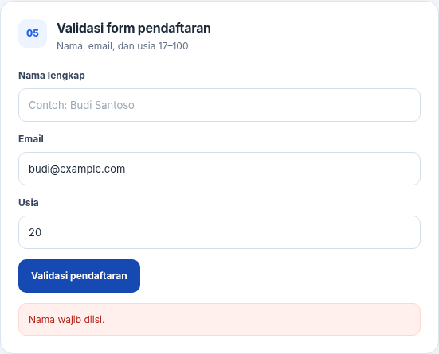 |
| Email tidak valid | 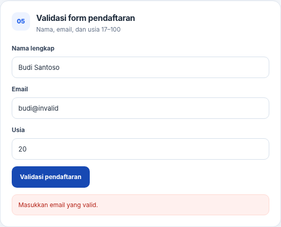 |
| Usia di bawah 17 | 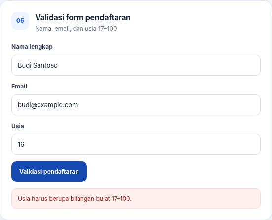 |
| Semua input valid | 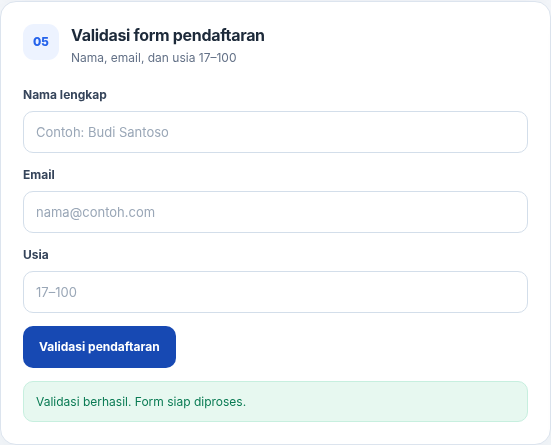 |

### Latihan 6 — To-do List
Pengguna dapat menambah tugas, menandai tugas selesai, dan menghapus tugas. Teks pengguna dimasukkan menggunakan `textContent`, bukan `innerHTML`.

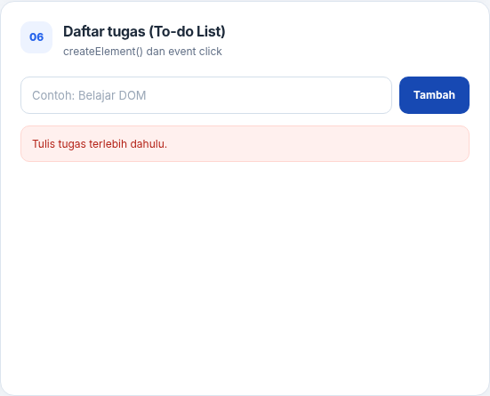

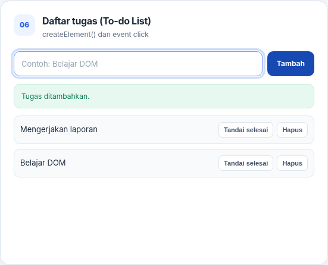

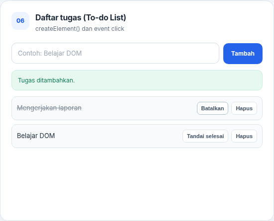

### Mini Project — Form Pendaftaran Workshop
Mini project menyediakan validasi nama (minimal 3 karakter), email, pilihan sesi, penghitung karakter, ringkasan real-time, pesan status, event `change` pada dropdown, dan tombol reset.

| Kasus uji | Screenshot |
|---|---|
| Form kosong / nama belum memenuhi syarat | 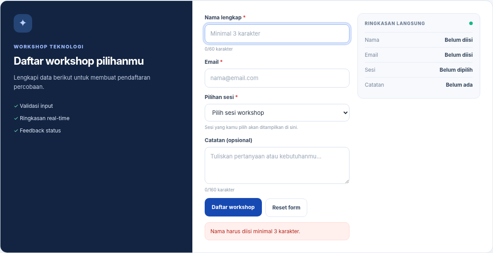 |
| Nama kurang dari 3 karakter | 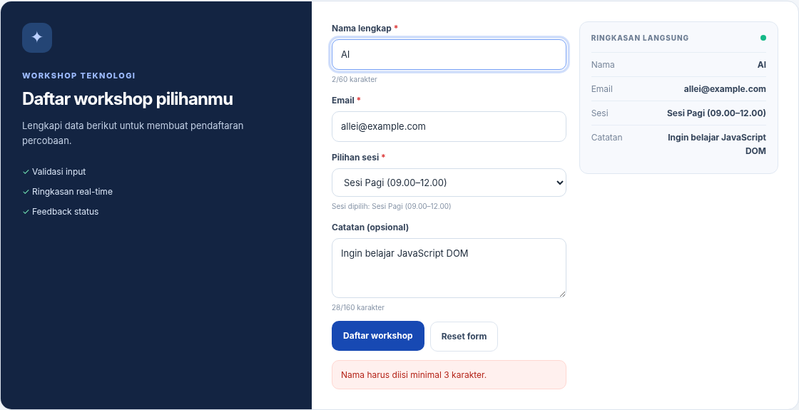 |
| Format email tidak valid | 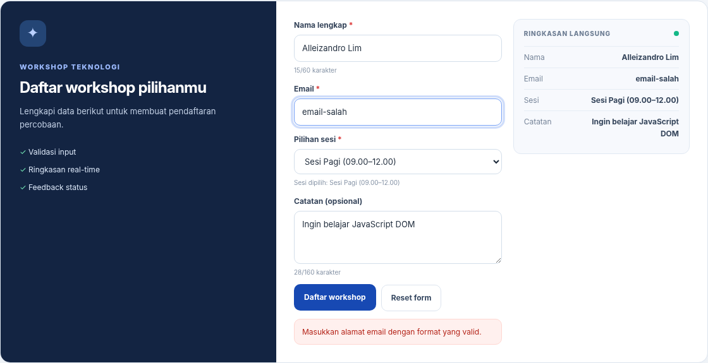 |
| Sesi belum dipilih | 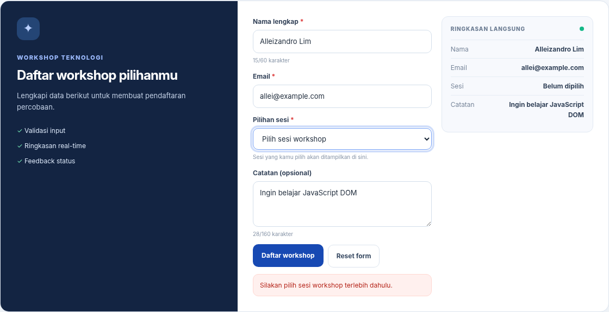 |
| Pendaftaran valid dan ringkasan tampil | 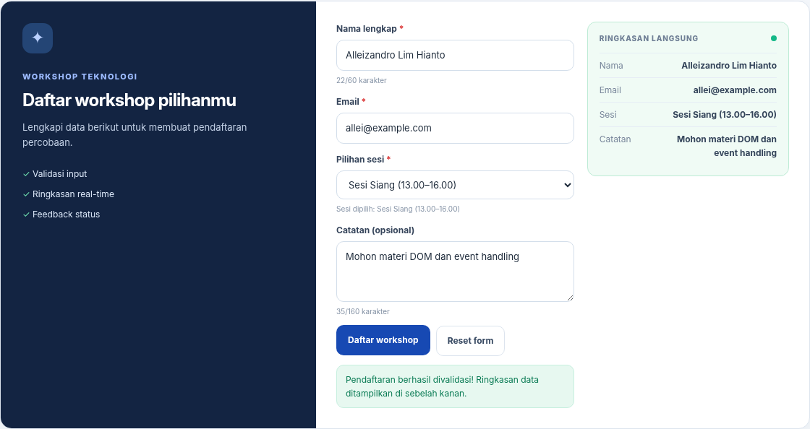 |
| Form setelah reset | 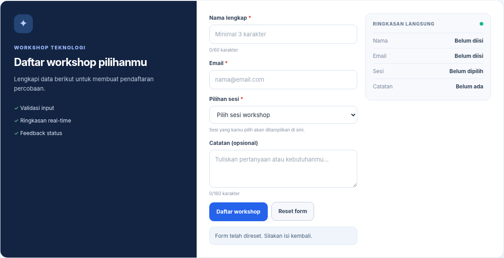 |

### Eksperimen Mandiri

1. **Hapus satu item:** tombol **Hapus** tersedia di setiap item To-do List.
2. **Nama minimal 3 karakter:** nama satu atau dua karakter ditolak saat form workshop dikirim.
3. **Event `change`:** pilihan sesi mengubah keterangan sesi dan ringkasan.
4. **Sembunyikan/tampilkan:** tombol mengubah class `hidden` pada paragraf.
5. **Script tanpa `defer`:** halaman menjelaskan bahwa script pada `<head>` bisa berjalan sebelum elemen HTML tersedia; akibatnya selector dapat menghasilkan `null`.

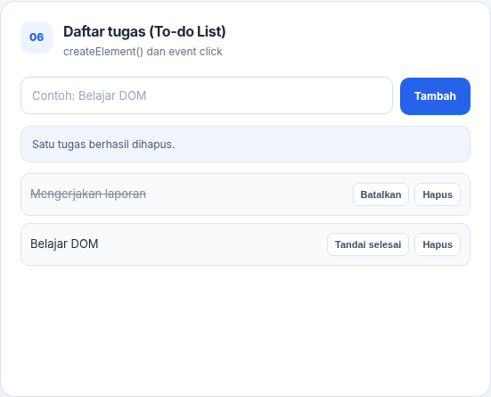

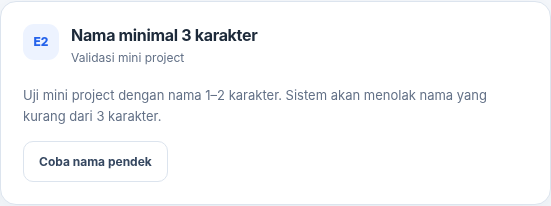


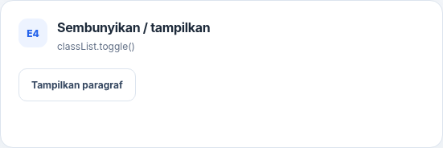

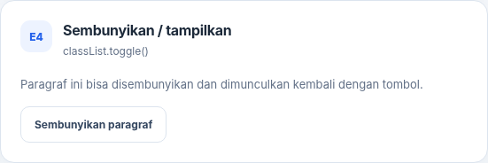

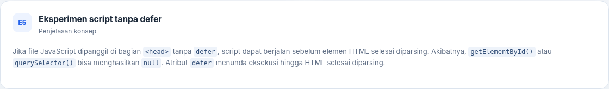

### Tampilan Mobile
Layout juga diperiksa pada viewport mobile agar kartu dan form tersusun vertikal.

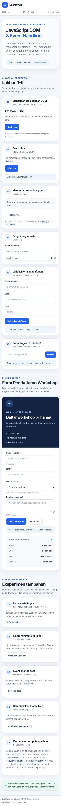

## 5. Hasil Pengujian

- Enam latihan utama dan mini project dapat dijalankan.
- Validasi form menghasilkan pesan yang sesuai untuk kondisi kosong, nama terlalu pendek, email tidak valid, sesi belum dipilih, dan input valid.
- To-do List mendukung tambah, selesai/batalkan selesai, dan hapus item.
- Event `input`, `change`, `click`, dan `submit` digunakan sesuai fungsinya.
- Pengujian otomatis dengan browser berhasil dijalankan tanpa error JavaScript pada console.

## 6. Upload ke GitHub

Buat repository kosong bernama `Lab6Web` di GitHub, lalu jalankan perintah berikut dari folder proyek:

```bash
git init
git add .
git commit -m "Praktikum 6 DOM dan Event Handling"
git branch -M main
git remote add origin https://github.com/USERNAME/Lab6Web.git
git push -u origin main
```

Ganti `USERNAME` dengan username GitHub sendiri. Jika Git sudah terhubung ke remote, jangan jalankan `git remote add origin` untuk kedua kalinya.

## 7. Jawaban Pertanyaan Evaluasi

Jawaban untuk seluruh tujuh pertanyaan evaluasi disediakan dalam dokumen terpisah: **[Jawaban_Evaluasi_Lab6Web.pdf](Jawaban_Evaluasi_Lab6Web.pdf)**.
